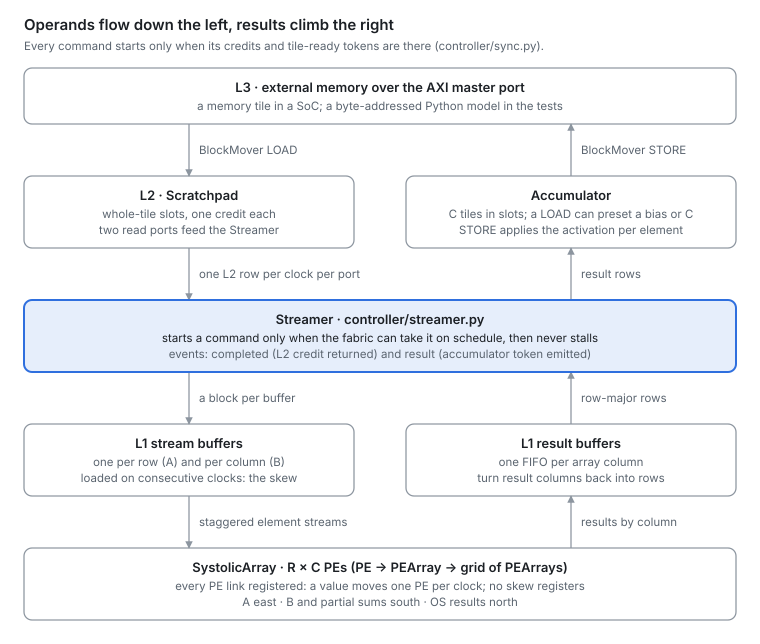

# The Systolic Tile

`SystolicTop` ([`src/systars/top.py`](../../src/systars/top.py)) is a compute tile with three
memory levels and two data-moving processes. It follows the CSP model of
[kpu-sim](https://github.com/stillwater-sc/kpu-sim): processes push whole tiles downstream when
the downstream buffer has room, and nobody polls or requests data.

The left column carries operands down from L3 to the fabric; the right column carries results
back up. The Streamer is the only process that touches both columns.

## The compute hierarchy

Built bottom up, each level a `lib.wiring.Component`:

| Level | File | What it is |
|---|---|---|
| `PE` | `core/pe.py` | One MAC with an input register on every link. Run-time mode: output-stationary (0) or stationary (1). |
| `PEArray` | `core/pe_array.py` | A `tile_rows x tile_cols` block of PEs. Purely structural, since every link is already registered. |
| `SystolicArray` | `core/systolic_array.py` | A `grid_rows x grid_cols` grid of PEArrays, 8x8 to 64x64 PEs. No skew or deskew registers. |
| `SystolicTop` | `top.py` | The tile: fabric, scratchpad, Combiner, controllers, BlockMover engines and the command queues. |

## The memory levels

SYSTARS uses KPU names for its memories, never cache names:

| Level | Implementation | Written by | Read by |
|---|---|---|---|
| L3 | Outside the tile, over AXI | BlockMover STORE | BlockMover LOAD |
| L2 | `memory/scratchpad.py`, two read ports | BlockMover LOAD | Streamer |
| Combiner | `memory/combiner.py` | Streamer results; a LOAD with `LocalAddr` bit 31 | BlockMover STORE |
| L1 | `memory/stream_buffer.py` | Streamer | The fabric (stream buffers); the Streamer (result buffers) |

## The processes

The **BlockMover** has two legs: LOAD (L3 to L2 or the Combiner; `controller/load.py`,
`blockmover/reader.py`) and STORE (Combiner to L3; `controller/store.py`, `blockmover/writer.py`). It moves
a whole tile per command: `len` rows, `stride` bytes apart, `row_bytes` each, from any byte
address, with no AXI burst crossing a 4 KB boundary.

The **Streamer** (`controller/execute.py`) turns L2 tiles into element streams through L1 and
writes the results into the Combiner.

Every command carries `cmd_sync`: the slots it reads and fills, and the ACQUIRE, SIGNAL, WAIT
and RELEASE flags that take and return credits and tile-ready tokens (`controller/sync.py`). The
[ISA page](../isa-instructions.md) specifies the commands, opcodes and flags.

## Configuration

One dataclass, `SystolicConfig` (`config.py`), sets everything: the grid and tile shape,
`input_bits` (default 8), `acc_bits` (32), the supported `dataflow` flags (default
`OUTPUT_STATIONARY | B_STATIONARY`), scratchpad and Combiner capacity, slot counts and
queue lengths. The presets are `DEFAULT_CONFIG`, `LEAN_CONFIG`, `CHIP_CONFIG` and
`LARGE_CONFIG`. The RTL targets in `targets.py` use small shapes, such as the 4x4
`systolic_top` that the cocotb tests run (`python3 -m systars.targets list`).

## The three dataflows

One fabric runs all three dataflows. The PE has only two modes: weight-stationary (WS) and
input-stationary (IS) differ only in which operand the ISA lays out as stationary. A `CONFIG`
command selects the mode at run time (`rs1`: 0 = OS, 1 = WS, 2 = IS), and `SystolicConfig.dataflow` decides which modes are built: WS needs `B_STATIONARY`
and IS needs `A_STATIONARY`, so the default (`OUTPUT_STATIONARY | B_STATIONARY`) builds OS
and WS.

| | Output-stationary (OS) | Weight-stationary (WS) | Input-stationary (IS) |
|---|---|---|---|
| Held in each PE | C[i, j], the running sum | one element of B | one element of Aᵀ |
| Streamed east | A, row-major in L2 | A, column-major in L2 | B |
| Moves south | B, column-major in L2 | partial sums | partial sums |
| Results leave | north, on the `last` marker | south | south, as Cᵀ |
| Layout fix-up | B loaded with a `TRANSPOSE` LOAD | A loaded with `TRANSPOSE` | STORE with `TRANSPOSE` turns Cᵀ into C |
| Per command | `COMPUTE` streams K <= KB elements | `PRELOAD` B, then `COMPUTE` streams M <= KB rows | `PRELOAD` A, then `COMPUTE` streams B |
| Conv2d | yes | not yet | not yet |

KB is the longest block a stream buffer holds: one L2 row, `sp_width / input_bits` elements.

**Output-stationary.** Three markers travel east with A: `valid`, `first` and `last`. `first`
makes the PE overwrite instead of accumulate, so a reduction needs no clear and may span
several commands (`cmd_chain`), with C held in the PEs between them. On `last`, the PE launches
`c + a * b` into the `c_up` register of the PE to its north. PE(i, j)'s result leaves the north
edge in clock `s + K + j + 2i`, so each column delivers one result every other clock.

**Stationary.** The stationary register `w` is loaded through a registered chain down each
column while `in_shift` is high; only the shift enable is broadcast. Each PE computes
`out_psum = in_psum + a * w`, and the column sum leaves the south edge as a finished result.

### Schedule rules

These come from the Streamer's docstring and are checked by the tests:

- The next command starts `I` clocks after the previous one: `I = max(K, R, C)` for OS,
  `max(M, R)` for stationary and `R` for `PRELOAD`. With `K >= R, C`, the next tile's blocks reach L1 as the previous ones
  finish. In OS, back-to-back reductions are also bound by the drain rule below.
- **The OS drain rule.** A command that ends a reduction starts so its results leave `2R - 1`
  clocks after the previous reduction's, so two results never collide on a north link. With `K >= 2R - 1` (chained K tiles count) the rule costs nothing; on a 4x4 array
  with `K = 4`, consecutive single-command reductions start 7 clocks apart instead of 4.
- `PRELOAD` waits until the previous stationary stream has left the array; `CONFIG` waits
  until the Streamer is idle.

## Current limits

- `SystolicTop` and the controllers are not synthesis targets yet: `just synth` covers the PE,
  the arrays, the scratchpad and the Combiner.
- The L2 behind the Streamer is an idealized scratchpad with two read ports; the banked L2 that
  sustains two vectors per clock is open (#17).
- Conv2d runs only in OS. WS and IS need a column-write LOAD
  (branes-ai/embodied-ai-soc-generator#25).
- Matmul loads both operand tiles for every output tile (`isa/matmul.py`), so L3 supplies A
  once per column of C tiles and B once per row of C tiles: correct, but not traffic-optimal.
- The hardware loop unrollers (`LoopMatmul`, `LoopConv`) are not built; today the ISA
  instructions issue the tiled command streams.
