# Systolic Array Wavefront Visualization

A systolic array is a *wavefront* array: the elements of A and B meet at each PE in a
sweep that crosses the array along its anti-diagonals, one PE per clock. This page shows
it in three steps, each a bit larger than the last, and every animation on it is
recorded from the generated RTL and checked against the predicted wavefront:

1. [The reduction](#1-the-reduction-2x2): what one PE computes, clock by clock (2x2).
2. [The stagger](#2-the-stagger-4x4): how the L1 stream buffers line the elements up (4x4).
3. [The schedule](#3-the-schedule-16x16): the front sweeping a 16x16 array, tile after
   tile with no gap between them.

Each step is shown for both fabric modes: output-stationary (OS), and the stationary mode
(weight-stationary, WS; input-stationary, IS, is the same fabric mode with the operands
swapped).

## Why a wavefront?

Matrix multiplication reuses every operand:

```
C[i,j] = Σ A[i,k] × B[k,j]  for k = 0 to K-1
```

Each element of A is used for a whole row of C, and each element of B for a whole column.
A systolic array reads each element from memory once and passes it from PE to PE: A moves
east along a row, B moves south down a column (OS), and each PE multiplies what passes
through it. For the right pair to meet, row `i`'s stream starts `i` clocks after row 0's,
and column `j`'s `j` clocks after column 0's. Then A[i, k] and B[k, j] both reach PE(i, j)
in clock `1 + i + j + k`, and for each `k` the PEs that are working on it form an
anti-diagonal that moves one PE further every clock: the wavefront.

In the RTL every PE link is registered (`core/pe.py`), and the array itself has no skew
registers: the stagger comes from the **L1 stream buffers** (`memory/stream_buffer.py`).
The Streamer loads them on consecutive clocks, so buffer `i` starts one clock after buffer
`i - 1`.

## 1. The reduction (2x2)

A 2x2 array with K = 3 and single-digit operands. Each PE shows the operands in its input
registers (`a·b`), its running sum `c` and the `k` it is working on. The strips on the
west and north edges are the L1 stream buffers, showing what each one feeds the array in
that clock. On its last product (`k = 2`) a PE sends `c` north, one PE per clock (`↑`),
into the L1 result buffer, and C fills in on the right. The loop ends with `C == A @ B`,
as the RTL computed it.



In the stationary mode the weights shift into the array first (preload, one row per
clock), and each PE holds its weight `w`. Element `m` of the stream (a row of A) moves
east, and the partial sum `Σ = A[m, :r+1] @ W[:r+1, j]` moves south. It leaves the south
edge as `C[m, j]`.



## 2. The stagger (4x4)

A 4x4 array, built as a 2x2 grid of 2x2 PEArrays (the thick lines). Each cell shows which
element is meeting there: `kN` (OS) or `mN` (stationary), one colour per `k` or `m`. On the
edges, each L1 stream buffer starts one clock after its neighbour: row `i` feeds its
element `k` in clock `i + k`, and column `j` feeds in clock `j + k`. So A[i, k] and B[k, j]
reach PE(i, j) together, in clock `1 + i + j + k`. A given `k` reaches the PEs of one
anti-diagonal (`i + j` constant) in the same clock and the next anti-diagonal a clock later
(`k = 0` is at PE(0, 0) in clock 1 and at PE(0, 1) in clock 2), so each colour moves
across the array as a diagonal band.
After the last `k`, the results (`cN`) move north, and each column's results leave every
other clock.





PEArray boundaries are structural only. Every PE link is registered, so the wavefront
crosses a PEArray boundary exactly as it moves inside one.

## 3. The schedule (16x16)

A 16x16 array, three tiles back to back, K = 32 (OS) or M = 32 (stationary). At this size
the values don't matter: each cell is coloured by the `k` (or `m`) meeting there, so each
anti-diagonal is one colour, and the front sweeps the array.

- **Fill:** the front crosses the array, reaching the far corner in clock `R + C - 1`.
- **Steady state:** every PE is busy. The next tile's front (the colours start again)
  follows the last one with no gap: the Streamer loads the next tile into each L1 buffer
  in the clock the previous tile's last element leaves it.
- **Drain:** the last front leaves, and in OS the results move north (the dots), each
  column emptying every other clock.

The plot under the array is the fraction of PEs busy in each clock. It stays at 100% across
the tile boundaries.





Tiles follow each other on the Streamer's schedule (`controller/execute.py`, "Schedule"):

- **OS.** A tile of reduction length `K` starts `max(K_prev, R, C, K_prev - K + 2R - 1)`
  clocks after the previous one, of length `K_prev`. The first three terms are the streams:
  an L1 buffer takes the next block in the clock the last element of its current block
  leaves it (`K_prev`), and the Streamer reads a tile's `R` A rows and `C` B columns from L2
  on consecutive clocks, one per lane (`R`, `C`). The last term keeps the results apart: a
  reduction's results leave the north edge at least `2R - 1` clocks after the previous
  reduction's, so that results never meet on a north link. For tiles of equal length the
  interval is `max(K, R, C, 2R - 1)`, and the tiles stream with no bubble when it is `K`:
  when `K >= C` and `K >= 2R - 1` (here K = 32, C = 16, 2R - 1 = 31). A wide array costs a gap even with a long enough K: R = 2, C = 6,
  K = 3 starts a tile every 6 clocks. With a shorter K, each reduction waits for the drain:
  `python examples/gemm/08_rtl_wavefront.py --stage 3 --n 8 --svg out.svg` shows the gaps.
- **Stationary.** The next tile starts `max(M_prev, R)` clocks after the last, and there's
  no north drain, so `M >= R` is enough.

`wavefront.streamer_starts` is this schedule, and `tests/unit/test_execute_controller.py`
checks it against the Streamer itself.

## How the animations are made, and checked

`systars.wavefront` runs the `SystolicArray` RTL in simulation, driven as the L1 stream
buffers drive it, with each tile started on the Streamer's schedule. It records what every
PE holds in every clock and checks it against the prediction:

- **Output-stationary:** A[i, k] meets B[k, j] at PE(i, j) in clock `s + 1 + i + j + k`,
  where `s` is the clock the tile starts. PE(i, j)'s result leaves the north edge of column
  `j` in clock `s + K + j + 2i`.
- **Stationary:** element `m` meets W[r, j] at PE(r, j) in clock `s + 1 + r + j + m`, with
  the partial sum `A[m, :r+1] @ W[:r+1, j]`. It leaves the south edge of column `j` in clock
  `s + R + j + m`.

Every cell is checked by value against the operands: its `a` and `b` (OS), or its `a`,
`w` and outgoing partial sum (stationary). So the colour or label a cell shows is the one
the RTL confirmed. A cell where the RTL departs from the prediction is drawn red (`X`). The
check also covers the clock every result leaves the array, and the result itself, so each
PE's final sum is checked as the result it sends. The OS accumulator inside the PE is not
a port and isn't recorded: the running sums the value view shows (`c = ...`) are computed
from the operands the RTL recorded, and an intermediate sum the RTL got wrong would show
up as a wrong result, not as a red cell. `render_svg` draws a trace in the `value`,
`index` or `front` view. Each cell's colour and text is one SMIL animation, so the files
stay small (the 16x16 OS animation is about 320 KB). They carry their own light and dark
colours, and the palette (viridis) is colour-blind safe.

The SVGs in `docs/wavefront/` are generated and committed. To regenerate them after a
change to the RTL or the renderer:

```bash
just wavefronts          # rewrite docs/wavefront/*.svg (fails if the RTL departs from the prediction)
just wavefronts-check    # fail if a committed SVG is stale
```

`tests/unit/test_wavefront.py` fails in CI when a committed SVG is stale. It also checks
every stage against the prediction, that the value view's sums are `A @ B`, that the 16x16
tiles run without an idle clock, and the size of the SVG.

To draw other shapes:

```bash
# A stage of the progression, OS or WS
python examples/gemm/08_rtl_wavefront.py --stage 2 --dataflow ws --svg out.svg

# Any shape: 8x8 as 4x4 PEArrays, K = 12, two tiles, printed as text frames too
python examples/gemm/08_rtl_wavefront.py --grid 2 2 --tile 4 4 --n 12 --tiles 2 --text --svg out.svg
```

It exits non-zero if the RTL departs from the predicted wavefront.

## Aside: the textbook model (examples 02 and 03)

`examples/gemm/02_animated_wavefront.py` (a terminal animation) and
`examples/gemm/03_wavefront_gif.py` (a GIF) animate a **conceptual** Python model of a
textbook systolic array, not the RTL. It is a square array whose inputs are skewed by delay
registers at the edges, and whose results stay in the PEs. That is how the idea is usually
taught, and it is the same wavefront: in the RTL, the L1 stream buffers do the skewing, and
OS results drain north. Use these for a quick terminal demo or a GIF for slides. Use the
animations above for what the hardware does.

```bash
python examples/gemm/02_animated_wavefront.py --m 3 --n 3 --k 3 --step   # Enter: next clock
pip install matplotlib pillow
python examples/gemm/03_wavefront_gif.py --size 4 --fps 1 --output wavefront.gif
```

## Further reading

- H.T. Kung, "Why Systolic Architectures?", IEEE Computer, 1982
- [ISA instructions](isa-instructions.md): the fabric, L1 and the Streamer, as the Matmul
  and Conv2d instructions drive them
